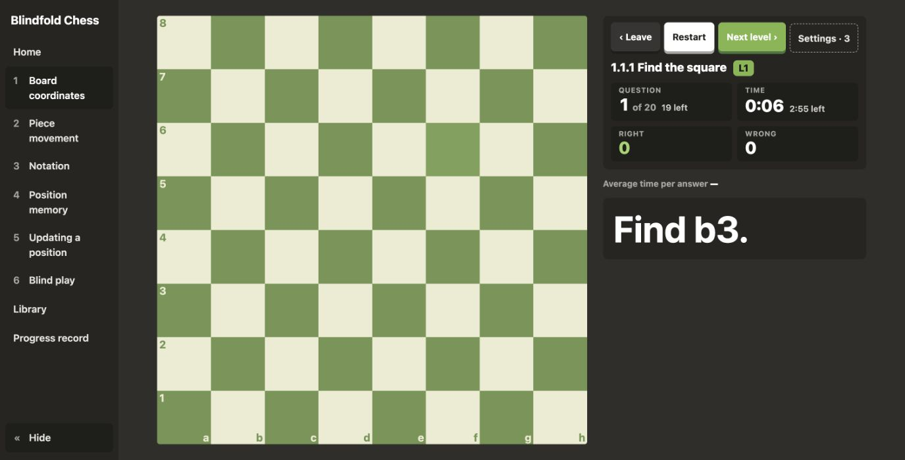

# Blindfold Chess

I built this trainer to play chess without seeing pieces.
It turns that goal into short, focused exercises.

**[Play in your browser](https://ceasar369.github.io/blindfold-chess/)**
· [Download the source](https://github.com/Ceasar369/blindfold-chess/archive/refs/heads/main.zip)



**What you can practise**

- Board coordinates and square colours.
- Piece movement and legal moves.
- Reading and writing chess notation.
- Remembering positions after the board hides.
- Updating positions as moves arrive.
- Blind play, from puzzles to games against a bot.

**Why I made it**

I wanted an app shaped around my own practice.
I defined the exercises, interface, and feedback I wanted.
I used my [Claude behavior layer](https://github.com/Ceasar369/claude-behavior-layer) while building it.
This project shows the resulting app and its source.

**Run it locally**

Install Node.js 24, which includes npm.
Download this repository and open its folder in Terminal.

```sh
npm run setup
npm start
```

Open [the local game](http://127.0.0.1:4710).
Press Ctrl+C in Terminal to stop it.
The first setup downloads dependencies; playing needs no cloud account.

**Your progress**

The public game saves scores and progress in your browser.
Use the same browser and device to continue.
Clearing this site's browser data removes that progress.

The downloaded edition also saves completed rounds as local files.
Those files stay in this folder's `.data/records/` directory.
Back up `.data/` before moving or deleting your copy.

The launcher uses ports 4710 and 4711.
It keeps this copy separate from my personal installation.
It serves only this computer, through `127.0.0.1`.

**Inside the source**

- `code/app/core`: exercises, chess rules, and bundled training packs.
- `code/app/frontend`: React interface and browser progress.
- `code/app/backend`: local progress storage and optional cloud implementation.
- `code/blueprint/docs`: chapter descriptions used by existing tests.

Run `npm test`, `npm run check`, and `npm run build`.
The screenshot shows the existing interface without a redesign.

`npm run build:pages` builds the public, browser-only edition.
GitHub Actions checks, builds, and publishes it after changes.
The local edition retains its optional progress server.

**Credits and license**

Training packs use [Lichess's public data](https://database.lichess.org/).
[Third-party notices](THIRD_PARTY_NOTICES.md) identify bundled assets and dependencies.
MIT license. See [LICENSE](LICENSE).
